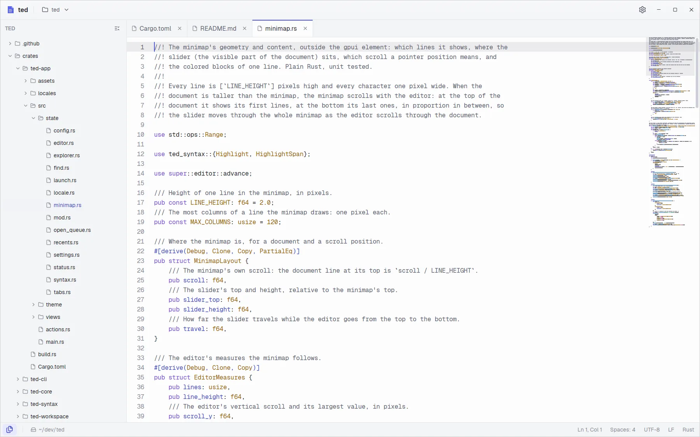

# ted

[](https://github.com/tanisperez/ted/releases/latest)
[](https://github.com/tanisperez/ted/actions/workflows/build.yml)
[](LICENSE)
[](https://github.com/tanisperez/ted/releases/latest)

A fast, lightweight, native text editor. It opens a 100 MB log in under 100 ms and scrolls it at
the display's refresh rate, browses folders of a hundred thousand files without waiting, and
does no work while idle. Tabs, syntax highlighting for code and logs, find in file, a minimap
and the settings in a plain text file. No accounts, no telemetry.

[Website](https://ted.tanis.codes) · [Download](https://ted.tanis.codes/install.html) ·
[Documentation](https://ted.tanis.codes/docs/)

<picture>
  <source media="(prefers-color-scheme: dark)" srcset="site/img/hero-dark.webp">
  
</picture>

## Install

Every release on [GitHub](https://github.com/tanisperez/ted/releases/latest) has packages for
Linux x86_64, Windows x86_64 and macOS on Apple silicon. Each one puts `ted` on the `PATH`
where the platform allows it, so `ted notes.md` or `ted .` open a file or a folder from a
terminal.

| Platform | Package | Notes |
| --- | --- | --- |
| Debian, Ubuntu | `ted_X.Y.Z_amd64.deb` | `sudo apt install ./ted_X.Y.Z_amd64.deb` |
| Fedora, openSUSE | `ted-X.Y.Z-1.x86_64.rpm` | `sudo dnf install ./ted-X.Y.Z-1.x86_64.rpm` |
| Arch Linux | `ted-X.Y.Z-1-x86_64.pkg.tar.zst` | `sudo pacman -U ./ted-X.Y.Z-1-x86_64.pkg.tar.zst` |
| Any Linux | `ted-X.Y.Z-x86_64.AppImage` | `chmod +x` and run it; nothing is installed |
| Any Linux | `ted-X.Y.Z-linux-x86_64.tar.gz` | `bin/ted` plus the desktop entry and icons in a `/usr` layout |
| Windows | `ted-X.Y.Z-windows-x86_64-setup.exe` | Per user install, no administrator rights: Start menu entry, `ted` on the `PATH`, "Open with ted" in Explorer |
| Windows | `ted-X.Y.Z-windows-x86_64-portable.zip` | `ted.exe` alone, nothing to install |
| macOS | `ted-X.Y.Z-macos-arm64.dmg` | Drag ted to Applications |

`SHA256SUMS` lists the checksums of every package. The packages are not signed yet: Windows
SmartScreen and macOS Gatekeeper warn the first time. On macOS, open it with right click, Open.

On macOS, to run `ted` from a terminal:

```sh
sudo ln -sf /Applications/ted.app/Contents/MacOS/ted /usr/local/bin/ted
```

## Building from source

ted needs a stable Rust toolchain (edition 2024). On Linux, the development packages of
Wayland, X11, xkbcommon, fontconfig and Vulkan:

```sh
sudo apt install build-essential pkg-config cmake libfontconfig-dev libfreetype-dev \
  libwayland-dev wayland-protocols libxkbcommon-dev libxkbcommon-x11-dev \
  libx11-xcb-dev libxcb1-dev libvulkan-dev
```

Then:

```sh
make release        # target/release/ted
make test           # every crate, no window needed
make help           # the other targets
```

The packages of a release are built by the `Release` workflow; `packaging/` has the scripts and
`docs/releasing.md` the steps.

## Documentation

The [user documentation](https://ted.tanis.codes/docs/) is on the website; its sources are in
`site/docs-src/`. For developers:

- [Architecture](docs/architecture.md): the crates and how a file is loaded, painted and saved.
- [Design system](docs/design-system.md): colors, sizes and every screen.
- [Performance](docs/performance.md): the targets, how they are measured and the results.
- [Releasing](docs/releasing.md): versions, the release workflow and the packages.

## Built with

- [Rust](https://www.rust-lang.org)
- [gpui-kit](https://crates.io/crates/gpui-kit), the gpui UI framework and its components
- [telaio](https://github.com/tanisperez/telaio), the design system shared with Postino

## License

[Apache-2.0](LICENSE).
